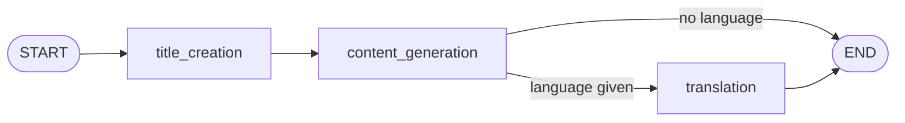

# BlogAgentic

A small multilingual blog generator built with **LangGraph**, **Groq** and **FastAPI**.

> **Note:** This is my **second agentic AI project**, built purely for **learning**.
> It is intentionally small: one graph, three nodes, one endpoint. It is not production software.

## What it does

Give it a topic (and optionally a language). It writes a blog title, writes the blog body, and, if a language was requested, translates both into that language. Any language the model supports works.



## What I was learning

- Modelling an agent workflow as a **StateGraph** (shared state, nodes, edges)
- **Conditional edges**: translating only when a language is requested
- Keeping prompts and nodes separate from graph wiring
- Wrapping a graph in a **FastAPI** endpoint with proper error handling
- Testing LLM code with a **fake LLM**, so tests need no API key or network

## Project structure

```
app.py                         FastAPI app (POST /blogs)
langgraph.json                 config for `langgraph dev`
src/blogagentic/
  graphs/graph_builder.py      builds and compiles the graph
  nodes/blog_node.py           title, content, translation nodes
  states/blogState.py          BlogState + Blog model
  llms/groq_llm.py             Groq LLM wrapper
tests/                         pytest suite (fake LLM)
```

## Setup

```bash
cp .env.example .env      # then put your real keys in .env
uv sync                   # or: pip install -r requirements.txt
```

You need a [Groq API key](https://console.groq.com). The LangSmith key is optional (tracing only).

## Run

```bash
python app.py             # API on http://localhost:8000
langgraph dev             # LangGraph Studio
```

```bash
curl -X POST localhost:8000/blogs -H "Content-Type: application/json" -d @request.json
curl -X POST localhost:8000/blogs -H "Content-Type: application/json" -d @request_language.json
```

Request body: `{"topic": "Agentic AI", "language": "French"}` (`language` is optional).

Response shape:

```json
{"data": {"topic": "Agentic AI", "current_language": "French",
          "blog": {"title": "...", "content": "..."}}}
```

`current_language` is absent when no language was requested.
Errors: `400` empty topic, `422` missing or invalid body, `502` LLM call failed.

## Tests

```bash
pip install -r requirements-dev.txt   # or: uv sync
pytest
```

## Known limitations

- Output quality depends entirely on the model; there is no fact-checking or web research step.
- No retries, caching, streaming or authentication.
- Translation quality is not verified by a human or a second model.
- Single model (`openai/gpt-oss-120b` on Groq), hardcoded in `groq_llm.py`.

## Possible next steps

Tone and length options, a review/revise loop, web search for sources, streaming responses.
